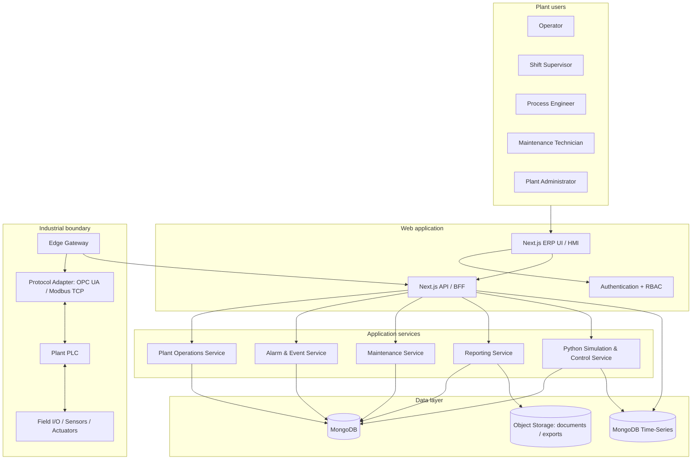
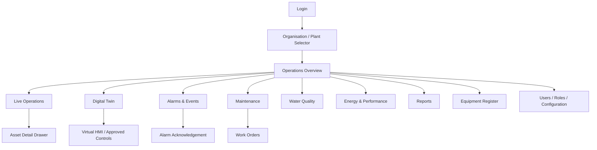
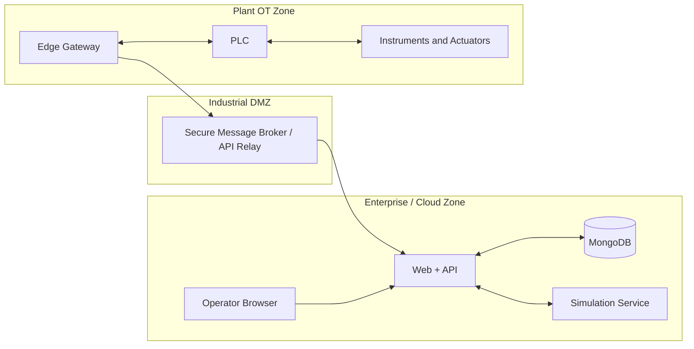

# System Architecture

## 1. Architecture goals

- ERP-like usability for plant personnel.
- Separation of business workflows, process simulation and industrial connectivity.
- Configurable multi-plant / multi-organisation data model.
- Live values with timestamps and quality.
- Auditable operator actions.
- Secure future PLC integration without exposing PLCs to the public internet.

## 2. Logical architecture



## 3. Runtime modes

### Mode A — Simulation
- Simulation service generates process values.
- Virtual PLC state machine evaluates permissives and simulated outputs.
- Commands affect only the simulated model.
- Persistent UI banner: `SIMULATION`.
- Seed data and generated measurements are labelled as synthetic.

### Mode B — Physical read-only
- Edge gateway reads approved PLC tags.
- Gateway publishes telemetry to the backend.
- Operator controls are hidden/disabled.
- UI shows gateway health, PLC quality, source timestamp and stale status.
- No command/write route is enabled.

### Mode C — Approved supervisory control (future, gated)
- Only after site-specific engineering, cybersecurity, safety and management approval.
- A command request passes RBAC, command validation, interlock/permissive validation, allow-list and gateway checks.
- PLC retains final authority and hardwired safety.
- Command is not considered successful until PLC acknowledgement and process feedback are observed.
- All requests, responses and state changes are audited.

Simulation and physical control must never both own the same actuator at the same time.

## 4. ERP navigation and screen hierarchy



## 5. Core services

| Service | Responsibility |
|---|---|
| Identity/RBAC | Login, session, organisation membership, permissions |
| Plant configuration | Plant, process area, asset, tag, setpoint configuration |
| Operations | Current status, commands, mode state |
| Simulation | Tank/pump/RO dynamics, virtual PLC, controller |
| Telemetry | Ingestion, validation, quality, persistence |
| Alarm/event | Rule evaluation, state lifecycle, acknowledgement |
| Maintenance | PM plans, work orders, parts/notes |
| Reporting | Aggregation, shift/daily reports and exports |
| Audit | Append-only record of sensitive actions and configuration changes |
| Gateway | Plant-network protocol access, buffering, mapping and secure transport |

## 6. Recommended repository structure

```text
aquatwin/
├── apps/
│   └── web/                      # Next.js App Router ERP/HMI
│       ├── app/
│       │   ├── (auth)/
│       │   ├── (dashboard)/
│       │   └── api/
│       ├── components/
│       ├── features/
│       │   ├── plants/
│       │   ├── operations/
│       │   ├── digital-twin/
│       │   ├── alarms/
│       │   ├── maintenance/
│       │   └── reports/
│       └── lib/
├── services/
│   ├── simulation/               # Python FastAPI + model
│   └── gateway/                  # Later, edge deployment
├── packages/
│   ├── ui/
│   ├── shared-types/
│   └── process-config/
├── docs/
├── infra/
│   ├── docker/
│   └── deployment/
└── tests/
```

## 7. Data flow

1. Sensor or simulation produces a measurement.
2. Source adapter normalises tag ID, value, unit, timestamp, quality and source.
3. Backend validates type, unit, range and plant mapping.
4. Valid telemetry is written to MongoDB time-series collection.
5. Alarm engine evaluates configured rules and creates/updates alarm state.
6. WebSocket/SSE publishes current state to authorised UI clients.
7. UI renders value, unit, source, timestamp and quality.
8. User command is stored as a request, validated, routed to virtual PLC or approved gateway, then updated with acknowledgement and final result.

## 8. Security architecture

- TLS for all network communication.
- MongoDB credentials only in server-side secrets; never use `NEXT_PUBLIC_MONGODB_URI`.
- Separate application credentials and least-privilege database roles.
- Tenant/plant scope applied server-side to every query.
- RBAC plus asset/action-level permissions.
- MFA for privileged roles where available.
- Session expiry and secure cookies.
- Audit log for login, configuration, command and acknowledgement events.
- Rate limits and request validation.
- Gateway outbound connection preferred; do not expose PLC ports to the internet.
- Network segmentation between enterprise IT and OT.
- Secrets manager for production credentials.
- Signed/versioned plant configuration.
- Backups and restore tests.
- Security review before any physical command capability.

## 9. Scalability and availability

- Start as a modular monolith for the ERP application; separate simulation and gateway because they have distinct runtime needs.
- Use a shared MongoDB connection pool per app process.
- Keep telemetry ingestion asynchronous and buffered.
- Use indexes based on plant, asset, tag and time.
- Apply retention/archive policy to high-volume measurements.
- Design gateway to buffer during temporary network loss and mark delayed data on replay.
- Use health endpoints and structured logs for web, simulation and gateway services.

## 10. Deployment environments

| Environment | Purpose | PLC access |
|---|---|---|
| Local development | Developer workflow | None |
| Demo/staging | Simulated plant and acceptance testing | None |
| Customer test | Approved read-only validation | Read-only, isolated |
| Production | Approved plant operation | Only explicitly approved functions |

## 11. Diagram: physical and software boundary



The exact topology must be approved by the plant's OT cybersecurity team. This is a logical concept, not a network implementation instruction.
